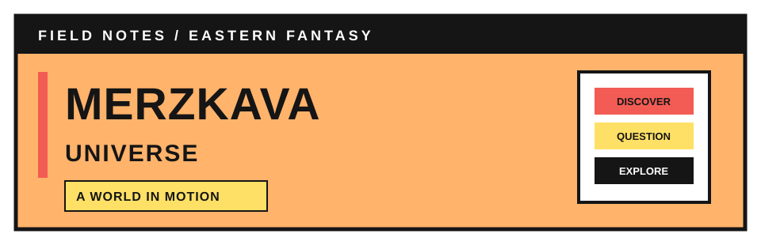

<!-- MERZKAVA UNIVERSE | PUBLIC NOTICEBOARD
Palette: orange #FFB36B + black #151515; white paper #FFFFFF with black type.
Accents: warm yellow #FFE066 and coral #F25C54. Teasers only; deep lore stays in the archive.
-->

### A CULTIVATION WORLD THAT DOESN'T STAND STILL.

**MARTIAL SOULS · SPIRIT RINGS · THINKERS · A WORLD OF CONSEQUENCES**

*Build your strength, uncover what history buried, and find out what your choices change.*

<!-- RP_SOURCE_START -->

### ✦ READY-TO-COPY ROLEPLAY HASH ✦

**Latest pinned source:** `dad3848`

<!-- RP_SOURCE_END -->

---

---

<strong>✦ Three powers, three different ways of life</strong>

Golden Dragon Empire, Tianhai Yunzhou, and Beiming Gu each have their own governments, cultures, resources, factions, and ambitions. Their differences shape trade, education, technology, prejudice, diplomacy, and the balance of power—without any one power controlling the whole world.

<strong>✦ Grow through more than raw strength</strong>

Martial Souls, Spirit Rings, Spirit Beasts, techniques, and the nine Spirit Realms shape cultivation. Thinkers follow a separate path through knowledge, formulations, and Artificial Artifacts. Ancient ruins, hidden factions, dangerous routes, and hard-to-find resources reward curiosity—but discovery is never guaranteed.

<strong>✦ The world keeps moving when you do</strong>

NPCs have their own priorities; trade, festivals, rivalries, and political tensions continue beyond a single scene. Travel has real routes and risks, resources depend on location, and actions can leave lasting consequences. Rumors aren't automatically facts, and strength doesn't erase every mistake.

---

 v0.4.98

**✦ ──── ❖ ──── ✦**

**THE LATEST FROM MERZKAVA**

*Five recent world and system updates*

**✦ ──── ❖ ──── ✦**

- ✦ **Pinned-Commit Roleplay Source and Automatic Hash Refresh**  
  The README now exposes a copyable commit hash for a stable snapshot of the roleplay source instead of relying on a moving `main` URL. A GitHub Actions workflow refreshes that hash after repository changes, keeping the displayed source one commit behind the newest README-refresh commit so the pinned reference does not chase itself.

- ✦ **Lean GM Routing and Pinned Snapshot Consistency**  
  The central INDEX is now shorter and routes regional/NPC canon through a specialist guide loaded only when relevant. Authority Order delegates detailed mechanics and ledger formulas to their single source modules. Bootstrap resolves the README's pinned SHA first, then reads all gameplay sources from that same commit to avoid mixing moving `main` content with an older snapshot.

- ✦ **Martial Soul Chance and Classification Unified Without Tier Labels**  
  The awakening module keeps the rarity chance, inherent-quality assessment, and mutation chance as separate procedures in one authoritative source. Martial Soul uses only the established names Common, Uncommon, Rare, Epic, Legendary, and Myth—never numeric Tier 1–9 labels or invented rarity names. The inherent-quality assessment cannot overwrite the actual rarity draw, and obsolete conflicting classifications are not retained.

- ✦ **GM Action Prompt Distinguished from Player Invocation**  
  The canonical gameplay template has absolute priority for GM output and ends with the exact prompt “••• Tentukan Aksimu (⁠｡⁠•̀⁠ᴗ⁠-⁠)⁠✧”. The player invocation template is explicitly limited to player input and cannot override GM response formatting.

- ✧ **Unified Item Pricing and Appraisal Scope Aligned**  
  Item prices continue to use one master formula combining economic quality tier, item condition, seasonal scarcity, demand, distribution, and local-market adjustments without double-counting factors. Routine goods—such as standard roadside food—use ordinary economic categories and local market pricing without mandatory specialist appraisal. The universal appraisal score and MAA ruling remain available for unusual, disputed, unidentified, or consequential classifications; GM predictions stay provisional and evidence-based.

**✧ ── ✦ ── ❖ ── ✦ ── ✧**

### YOUR NEXT LEAD

[**OPEN THE INDEX →**](INDEX.md) &nbsp; · &nbsp; [**ENTER THE WORLD ARCHIVE →**](world/WORLD.md)

The board introduces the world. The archive holds its deeper lore, geography, factions, and systems.

### READY TO STEP INTO MERZKAVA?

*Come discover the world, make your choices, and see where your story leads. Having fun? Bring your friends and family along—every new player brings another story to the world.*

**SHARE THE ADVENTURE** &nbsp; <a href="https://github.com/Antarezka/merzkava-universe">Explore Merzkava Universe</a> &nbsp; 

HOW TO PLAY?

🝰 Reach Authority_Phantom

---

**INVESTIGATION FILE // MERZKAVA UNIVERSE**

LIGHT ORANGE EDITION · ORANGE + BLACK · WHITE PAPER · YELLOW + CORAL ACCENTS

*Cultivate. Create. Explore. Choose—and live with what follows.*

