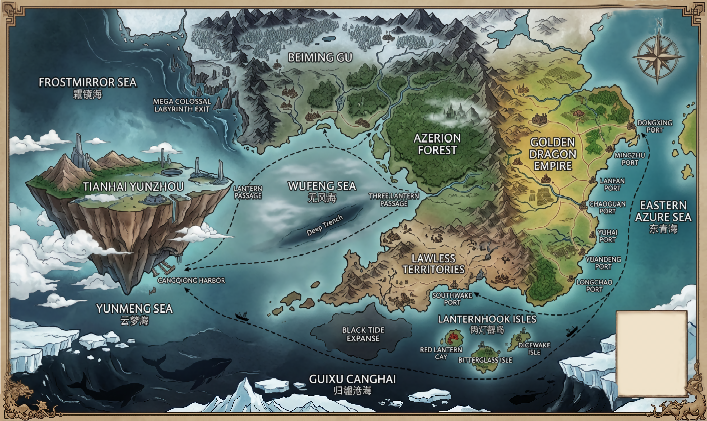
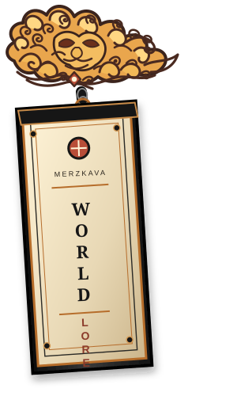
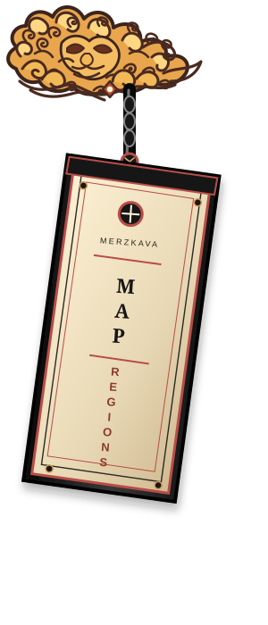

<!-- MERZKAVA UNIVERSE | PUBLIC NOTICEBOARD
Palette: orange #FFB36B + black #151515; white paper #FFFFFF with black type.
Accents: warm yellow #FFE066 and coral #F25C54. Teasers only; deep lore stays in the archive.
-->

<div align="center">


### A CULTIVATION WORLD THAT DOESN'T STAND STILL.

**MARTIAL SOULS · SPIRIT RINGS · THINKERS · A WORLD OF CONSEQUENCES**

*Build your strength, uncover what history buried, and find out what your choices change.*

</div>

<!-- RP_SOURCE_START -->
<div align="center">


### ✦ READY-TO-COPY ROLEPLAY HASH ✦

**Latest pinned source:** `2e678f3`

</div>
<!-- RP_SOURCE_END -->

---


---

<div align="center">


#### ✦ THE WORLD MAP OF MERZKAVA ✦

*Three powers. One world. Countless paths.*

<a href="assets/Untitled77_20261029054536.png"></a>

<sub>Tap the map to open the full-size image.</sub>

</div>

> **MAP STATUS — ILLUSTRATIVE REFERENCE**  
> This map offers a visual overview of Merzkava Universe. Some placements, boundaries, and connections may still need verification. When a visual detail conflicts with established lore, the official world and geography documents take precedence.

<div align="center">

༺━ ✦ ━༻


<div align="center">

<a href="world/WORLD.md"></a><a href="world/MAP_AND_REGIONS.md"></a>

</div>

<sub>THE MAP SHOWS THE WAY · THE ARCHIVE HOLDS THE DETAILS</sub>

༺━ ✦ ━༻

</div>

---


<details>
<summary><strong>✦ Three powers, three different ways of life</strong></summary>

Golden Dragon Empire, Tianhai Yunzhou, and Beiming Gu each have their own governments, cultures, resources, factions, and ambitions. Their differences shape trade, education, technology, prejudice, diplomacy, and the balance of power—without any one power controlling the whole world.

</details>

<details>
<summary><strong>✦ Grow through more than raw strength</strong></summary>

Martial Souls, Spirit Rings, Spirit Beasts, techniques, and the nine Spirit Realms shape cultivation. Thinkers follow a separate path through knowledge, formulations, and Artificial Artifacts. Ancient ruins, hidden factions, dangerous routes, and hard-to-find resources reward curiosity—but discovery is never guaranteed.

</details>

<details>
<summary><strong>✦ The world keeps moving when you do</strong></summary>

NPCs have their own priorities; trade, festivals, rivalries, and political tensions continue beyond a single scene. Travel has real routes and risks, resources depend on location, and actions can leave lasting consequences. Rumors aren't automatically facts, and strength doesn't erase every mistake.

</details>

<div align="center">

<div align="center">


</div>

<table align="center" width="100%">
<tbody>
<tr>
<td>
<strong>WORLD DESIGN</strong> <sub>— Worldbuilding & setting depth</sub><br/>
<strong>9.2 / 10</strong><br/>
<span style="color:#F25C54">▰▰</span><span style="color:#FFB36B">▰▰▰▰▰▰▰</span><span style="color:#D9D9D9">▱</span>
<sub>Three major powers, distinct political and cultural structures, hidden territories, factions, resources, and connected world lore.</sub>
</td>
</tr>
<tr>
<td>
<strong>GAMEPLAY SYSTEM</strong> <sub>— Mechanics & progression</sub><br/>
<strong>9.0 / 10</strong><br/>
<span style="color:#F25C54">▰▰</span><span style="color:#FFB36B">▰▰▰▰▰▰▰</span><span style="color:#D9D9D9">▱</span>
<sub>Cultivation realms, Martial Souls, Spirit Rings, Spirit Beasts, Sync progress, eligibility conditions, and defined character-state fields.</sub>
</td>
</tr>
<tr>
<td>
<strong>STATE CONTINUITY</strong> <sub>— State tracking & continuity</sub><br/>
<strong>9.0 / 10</strong><br/>
<span style="color:#F25C54">▰▰</span><span style="color:#FFB36B">▰▰▰▰▰▰▰</span><span style="color:#D9D9D9">▱</span>
<sub>Character profiles track HP, Satiety, Qi, equipment, inventory, building assets, and the five-denomination Xuan currency wallet.</sub>
</td>
</tr>
<tr>
<td>
<strong>GM AUTHORITY</strong> <sub>— Rule hierarchy & source control</sub><br/>
<strong>9.2 / 10</strong><br/>
<span style="color:#F25C54">▰▰</span><span style="color:#FFB36B">▰▰▰▰▰▰▰</span><span style="color:#D9D9D9">▱</span>
<sub>Authority and gameplay templates define source precedence, validation requirements, and boundaries for unsupported mechanics and hidden information.</sub>
</td>
</tr>
<tr>
<td>
<strong>WORLD SIMULATION</strong> <sub>— Long-term simulation potential</sub><br/>
<strong>8.5 / 10</strong><br/>
<span style="color:#F25C54">▰▰</span><span style="color:#FFB36B">▰▰▰▰▰▰</span><span style="color:#D9D9D9">▱▱</span>
<sub>NPC priorities, regional resources, travel risks, trade, political tensions, and lasting consequences provide systems for ongoing world activity.</sub>
</td>
</tr>
<tr>
<td>
<strong>NARRATIVE & AGENCY</strong> <sub>— Narrative & player agency</sub><br/>
<strong>8.0 / 10</strong><br/>
<span style="color:#F25C54">▰▰</span><span style="color:#FFB36B">▰▰▰▰▰▰</span><span style="color:#D9D9D9">▱▱</span>
<sub>Scene-based narration, social hooks, character goals, and open-ended action prompts support player-directed story progression.</sub>
</td>
</tr>
<tr>
<td>
<strong>RULE ENFORCEMENT</strong> <sub>— Rule enforcement & error resistance</sub><br/>
<strong>7.5 / 10</strong><br/>
<span style="color:#F25C54">▰▰</span><span style="color:#FFB36B">▰▰▰▰▰</span><span style="color:#D9D9D9">▱▱▱</span>
<sub>Explicit validation and state-change rules establish checks for unsupported actions and records; the parameter covers the rule controls defined by the system.</sub>
</td>
</tr>
</tbody>
</table>

<div align="center">

---

<sub>*INDEPENDENT RP SYSTEM BENCHMARK · PARAMETER-BASED COMPARISON*</sub>

</div>

<div align="center">

---


<table align="center">
<tr>
<td align="center">


[](https://github.com/Antarezka/merzkava-universe/tree/backup/nightly-v4.0.9-latest)

<sub><span style="color:#D4AF37"><strong>v4.0.9</strong></span></sub>

</td>
</tr>
</table>

<table>
<tr>
<td align="center">


<sub><span style="color:#D4AF37"><strong>v4.0.1</strong></span></sub>

</td>
<td align="center">


<sub><span style="color:#D4AF37"><strong>v4.0.4</strong></span></sub>

</td>
</tr>
</table>

---

**THE LATEST FROM MERZKAVA**

*Recent world and system updates*

---

- ✦ **Narrative Density & Mandatory Contextual GM Options**
  Hash: ``2e678f3`` | Ver: ``Nightly-v4.0.10`` · ``Stable-v4.0.1``
  Raises concrete Merzkava detail frequency throughout substantive scenes and hard-gates three distinct GM options when enabled, including a relevant in-world conversation/social topic or contextual observation alternative.

- ✦ **Authority Hierarchy & Living Merzkava Narrative**
  Hash: ``af2c709`` | Ver: ``Nightly-v4.0.9`` · ``Stable-v4.0.1``
  Tightens GM decision precedence and makes Narrative Dynamics the single operational narrative gate: everyday Merzkava life, ahli Spirit Realm, Thinker institutes, and canon-bound power scaling are mandatory in context without forced exposition.

- ✦ **Gameplay Response Template · Merzkava-First Narrative**
  Hash: ``24caaf2`` | Ver: ``Nightly-v4.0.7`` · ``Stable-v4.0.1``
  Compresses repeated narrative prompts while prioritizing Merzkava-specific cause-and-effect, bounded GM improvisation, independent NPCs, concrete timestamps, Satiety continuity, and final validation; required panels and mechanics remain mandatory.

- ✦ **Gameplay Template · Merzkava Narrative Gate**
  Hash: ``33408f1`` | Ver: ``Nightly-v4.0.6`` · ``Stable-v4.0.1``
  Streamlines repeated rules and strengthens causal Merzkava identity, bounded GM improvisation, concrete timestamps, and final validation while preserving all required panels, ledger, NPC, Thinker, and anti-cheat gates.

- ✦ **GM Bootstrap & Narrative Gate Optimization**
  Hash: ``395c77e`` | Ver: ``Nightly-v4.0.5`` · ``Stable-v4.0.1``
  Shortens bootstrap and narrative gates; lets the GM develop plausible unestablished scene details and choose a concrete session year while protecting canon, mechanics, player agency, and persistent state.

- ✦ **Classification Label Alignment · Plain Double-Backtick Text**
  Hash: ``a9548b2`` | Ver: ``Nightly-v4.0.4`` · ``Stable-v4.0.1``
  Aligns classification labels across INDEX, Authority Order, and the gameplay response template; appraisal explanations remain outside the label.


</div>


<div align="center">

༺━━━━━━ ✦ ━━━━━━༻

</div>

<div align="center">


---

</div>

```text
MERZKAVA UNIVERSE · ROADMAP
│
├─ World Expansion
│  └─ New settlements across shallow-sea areas
│     └─ Details and connections: under design
│
├─ Lore Development
│  ├─ Additional world history and regional lore
│  └─ Heaven Realm
│
└─ Canon Integration
   └─ Finalize details before adding them to active canon
```

<sub>Roadmap items are planned, not yet established canon. Details will be finalized before implementation.</sub>

<div align="center">

---

*The world grows when its canon is ready.*

---

</div>

<div align="center">

**✧ ── ✦ ── ❖ ── ✦ ── ✧**

</div>

<div align="center">


### YOUR NEXT LEAD

[**OPEN THE INDEX →**](INDEX.md) &nbsp; · &nbsp; [**ENTER THE WORLD ARCHIVE →**](world/WORLD.md)

<sub>The board introduces the world. The archive holds its deeper lore, geography, factions, and systems.</sub>

<sub><span style="color:#555555">HOW TO PLAY?</span></sub>

<sub><span style="color:#555555">🝰 Reach Authority_Phantom</span></sub>


### READY TO STEP INTO MERZKAVA?

*Come discover the world, make your choices, and see where your story leads. Having fun? Bring your friends and family along—every new player brings another story to the world.*

**SHARE THE ADVENTURE** &nbsp; <a href="https://github.com/Antarezka/merzkava-universe">Explore Merzkava Universe</a> &nbsp; <a href="https://github.com/Antarezka/merzkava-universe"></a>

---

**INVESTIGATION FILE // MERZKAVA UNIVERSE**

<sub>LIGHT ORANGE EDITION · ORANGE + BLACK · WHITE PAPER · YELLOW + CORAL ACCENTS</sub>

*Cultivate. Create. Explore. Choose—and live with what follows.*

</div>
